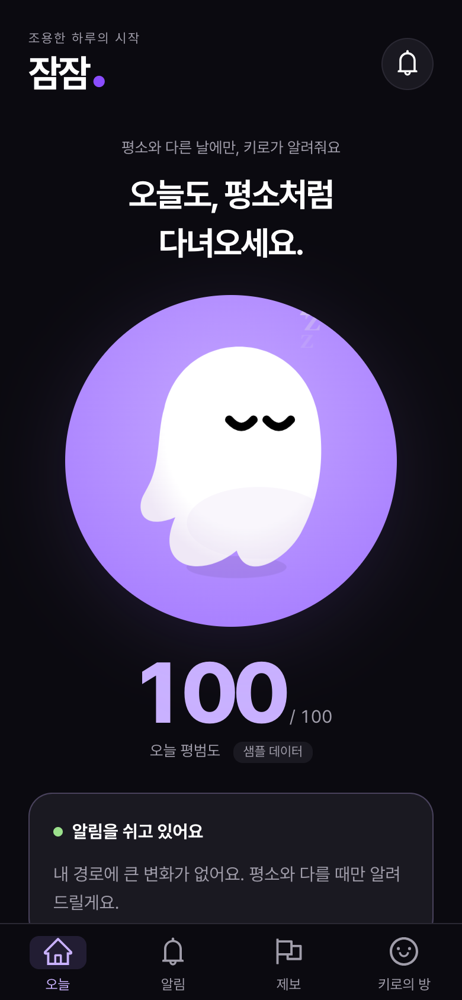
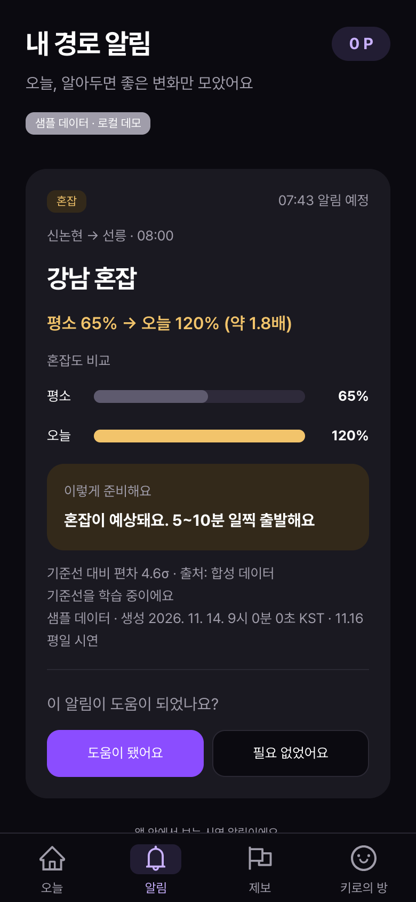
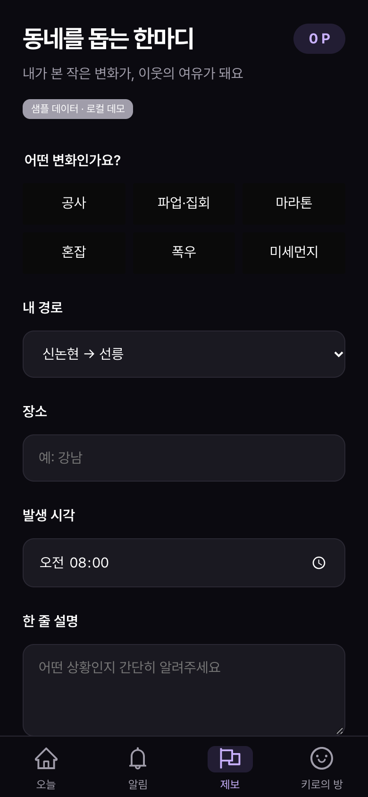
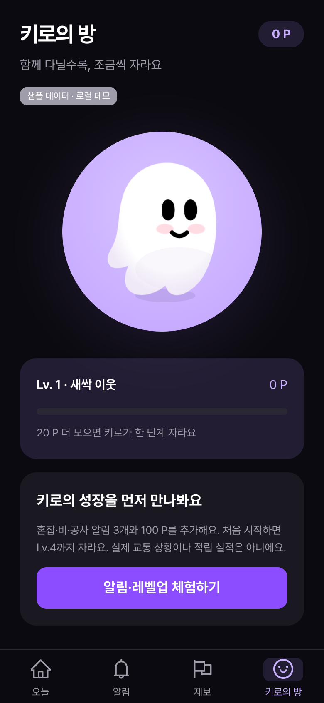

# 잠잠

**매일 같은 길로 출퇴근하는 사람이, 교통 알림에 묻혀 정작 오늘 평소와 다른 일을 놓치는 불편을 줄여 주는 앱입니다.** 평소와 다른 날에만 알려주고, 별일 없는 날에는 마스코트 '키로'가 인사합니다.

**Demo:** https://kirothon-team-019.vercel.app/ (모바일 화면에 맞춰져 있어요)

<p align="center">
  
  
  
  
</p>

---

## 1. 문제 정의

### 대상 사용자
- 같은 시간에 같은 길로 출근하는 직장인
- 정해진 시간에 아이를 데리러 가는 보호자

### 문제 상황
출근길 직장인이나 하원을 맡은 보호자가 매일 같은 길로 이동할 때(누가, 상황), 교통 앱의 알림과 정보가 늘 비슷하게 반복되면 오늘 정말 평소와 다른 일(공사, 혼잡, 폭우 등)을 알아채기 어렵고(불편), 그 결과 평소처럼 나섰다가 지각하거나 하원이 늦어질 수 있습니다(결과).

### 기존 방식과 한계
- 지금은 교통 앱을 열어 직접 확인하거나, 앱이 보내는 알림을 그때그때 읽습니다.
- 이 방식은 사용자가 매번 "오늘이 평소와 다른가"를 스스로 판단해야 합니다.
- 알림이 많으면 중요한 알림도 같이 묻힙니다. 이는 잠잠이 세운 가설이고, 특정 앱이 그렇다고 단정하지는 않습니다.

### 근거
- 평소와 비교할 수 있는 공공데이터가 실제로 있습니다.
  - [서울교통공사 혼잡도 정보](https://data.seoul.go.kr/dataList/OA-12928/S/1/datasetView.do): 요일·시간대·구간별 과거 혼잡도
  - [역별 일별 시간대별 승하차 인원](https://www.data.go.kr/data/15048032/fileData.do): 2025년 199,290행
  - [서울시 실시간 도시데이터](https://data.seoul.go.kr/dataList/OA-21285/F/1/datasetView.do): 지역의 현재 인구·교통·날씨·대기질
- 위 자료는 "평소와 비교하는 알림을 만들 수 있다"는 구현 가능성의 근거입니다. 알림 피로가 실제로 얼마나 줄어드는지는 사용자 실험을 하지 않아 아직 모릅니다.

### 목표
평범한 날에는 알림이 오지 않고, 내 길과 시간에 영향이 있는 변화가 있는 날에만 "무엇이 달라졌는지, 평소와 얼마나 다른지, 어떻게 하면 좋은지"를 알려주는 것입니다.

---

## 2. 핵심 기능

| 기능 | 해결하는 불편 | 코드 위치 |
|---|---|---|
| 내 경로 등록 (장소 검색, 대중교통 경로, 출발 시각, 요일) | 매번 앱을 열어 같은 길을 다시 찾아야 하는 번거로움 | `src/pages/Routes.tsx`, `src/features/transit/`, `api/` |
| 평소와의 비교 | 오늘이 평소와 다른지 직접 판단해야 하는 부담 | `scripts/collect/`, `src/features/baseline/` |
| 내 길·시간에 맞는 알림 판정 | 내게 상관없는 알림이 많아 중요한 알림이 묻히는 문제 | `src/engine/` |
| 이유가 보이는 알림 (변화, 평소와의 비교, 권장 행동, 출처) | 알림을 받아도 무엇을 해야 할지 모르는 문제 | `src/pages/NoticeDetail.tsx` |
| 알림 피드백 | 내게 맞지 않는 알림이 계속 오는 문제. '도움이 됐어요 / 필요 없었어요'로 알림 기준을 조정 | `src/state/`, `src/engine/threshold.ts` |
| 현재 지역 신호 (강남역, 여의도) | 지금 동네 상황을 따로 찾아봐야 하는 번거로움 | `src/pages/Home.tsx`, `api/` |
| 이웃 제보와 포인트 | 공공데이터에 없는 동네 변화를 알 수 없는 문제 | `src/features/reports/`, `src/features/points/` |
| 키로와 오늘 평범도 | 알림이 없는 날 앱이 제대로 동작하는지 알 수 없는 불안 | `src/pages/Home.tsx`, `src/pages/KiroRoom.tsx` |

기능별 구현 상태는 [평가·데이터·구현 현황](docs/EVALUATION.md)에 있습니다.

## 3. 사용 시나리오

1. **내 길 등록하기**: 출발지와 도착지를 검색해 대중교통 경로를 고르고, 출발 시각과 요일을 정해 저장합니다. 위치 권한은 필요 없습니다.
2. **평소와 비교하기**: 잠잠이 공공데이터로 만든 '평소'와 오늘 상황을 내 경로와 시간대에 맞춰 비교합니다.
3. **필요한 날만 알림 받기**: 내 길과 시간에 영향이 있으면 알림이 옵니다. 예를 들어 "강남 혼잡, 평소 65%에서 오늘 120%. 5~10분 일찍 출발하세요"처럼 나옵니다.
4. **피드백 남기기**: 알림에 '도움이 됐어요' 또는 '필요 없었어요'를 누르면 이후 알림 기준이 내게 맞게 조정됩니다.
5. **조용한 날은 키로와 함께**: 알림이 없는 날에는 키로가 '오늘 평범도'를 보여줍니다.
6. **이웃 제보하기**: 공사, 혼잡, 폭우 같은 동네 변화를 제보하면 10 P를 받고, 포인트로 키로를 키우고 꾸밉니다.

**바로 체험해 보기**
- 알림이 오는 모습: 오늘 화면 아래 '샘플 시나리오 바꾸기'에서 혼잡, 공사, 비 등을 고릅니다. 내 경로와 시간이 겹칠 때만 알림이 생깁니다.
- 키로가 자라는 모습: [이 링크](https://kirothon-team-019.vercel.app/?demo=1#kiro)를 열면 시연용 알림 3개와 100 P가 추가됩니다. 키로의 방에서 시연 데이터만 지울 수 있습니다.

## 4. 기대 효과

| 지금의 불편 | 잠잠을 사용하면 |
|---|---|
| 매일 출발하기 전에 교통 상황을 확인하기도 번거롭고, 확인하지 않으면 달라진 상황을 놓치기 쉽다. | 일일이 찾아보지 않고 한 곳에서 평소와 달라진 점만 모아 볼 수 있다. |
| 늘 다니던 길에 갑자기 문제가 생겼는데 모르고 출발해서, 지각하거나 아이를 데리러 가는 시간이 늦어진다. | 출발 전에 평소와 달라진 상황을 알려줘서, 일찍 출발하거나 다른 길로 갈 수 있다. 변화가 없는 날은 평소대로 나가면 된다. |
| 길이 막힌다는 소식은 들었지만, 평소보다 얼마나 심한지 감이 오지 않는다. | 평소와 오늘을 비교해서 얼마나 달라졌는지 알 수 있다. |
| 문제가 생긴 건 알지만, 어떻게 대비해야 할지 판단하기 어렵다. | "5~10분 일찍 출발", "우회 경로 확인", "마스크 착용"처럼 상황에 맞는 구체적인 행동을 안내받는다. |
| 나와 상관없는 교통 알림이 많아 정작 필요한 정보를 놓친다. | 내가 다니는 길과 이동 시간에 영향을 주는 변화만 알림으로 받는다. |
| 집 근처 공사나 갑작스러운 혼잡은 직접 가보기 전까지 알기 어렵다. | 이웃의 제보로 공공데이터에 없는 동네 상황도 미리 알 수 있다. |

## 5. 차별점

- **내 길과 시간에 맞는 알림**: 오늘 수치만 보지 않고, 평소와의 차이와 내 경로·출발 시각이 겹치는지를 함께 따집니다.
- **이유가 보이는 알림**: 무엇이 달라졌는지, 비교 기준이 무엇인지, 무엇을 하면 좋은지를 함께 보여줍니다.
- **조용한 날도 보이는 앱**: 알림이 없는 날에도 키로가 상태를 알려주고, 제보와 피드백으로 참여를 이어줍니다.
- **데이터를 구분해서 보여줌**: 과거 기준, 현재 관측, 샘플 데이터를 섞지 않고 화면에 출처를 표시합니다.
- **위치 추적 없음**: 사용자가 고른 출발지·도착지·경로만 저장합니다.

---

## 6. 설치와 실행

Node.js와 npm이 필요합니다. 저장소 루트에서 실행합니다.

```bash
# 1. 의존성 설치
npm ci --prefix src

# 2. 실행 (터미널에 표시되는 주소를 브라우저로 엽니다)
npm run dev
```

지도, 장소 검색, 경로 조회를 쓰려면 카카오와 ODsay API 키가 필요합니다. 설정 방법은 [설치·API 설정](docs/SETUP.md)을 참고하세요.

React, TypeScript, Vite, antd-mobile을 사용합니다.

## 7. 테스트

```bash
npm test             # 단위 테스트
npm run build        # 빌드 확인
npm run evaluate     # 샘플 상황 24개 평가 재현
```

배포된 [Demo](https://kirothon-team-019.vercel.app/)에서도 바로 확인할 수 있습니다.

---

## 팀

- **팀 번호:** team-019
- **팀명:** 반타블랙

| 이름 | 역할 |
|---|---|
| 박도형 | 기획, UI 디자인 시스템(Ant Design 기반), 상황 의상 우선 표시 수정, Kiro 서브에이전트 구조와 Supabase 제보·포인트 백엔드 |
| 박진우 | 기획, 이상 판정 엔진과 React 앱 MVP, 카카오맵·ODsay 경로 조회, 공공데이터 기준선 연동, 샘플 알림·레벨업, 제보 지도 표시, 대안 경로 추천, Vercel 배포, 배포 빈 화면·코스튬 장식 버그 수정 |
| 박은서 | 기획, 키로 캐릭터 디자인·애니메이션, Kiro 차단 훅(비밀 값·force push)과 실행 기록, steering 정리, 개발 기록 추적 표 |
| 김미주 | 기획, 서비스 기획서·PRD·기능명세, Kiro 스펙·steering·hooks, 개발 기록·README 작성, 훅 리뷰 반영과 키로 렌더러(Safari) 버그 수정 |

기여 기록: [GitHub Contributors](https://github.com/weeeeestern/kirothon-team-019/graphs/contributors)

더 자세한 자료: [발표 자료](PRESENTATION.pdf) · [개발 기록](BUILD_REPORT.md) · [데이터 출처 기록](data/SOURCES.md)
